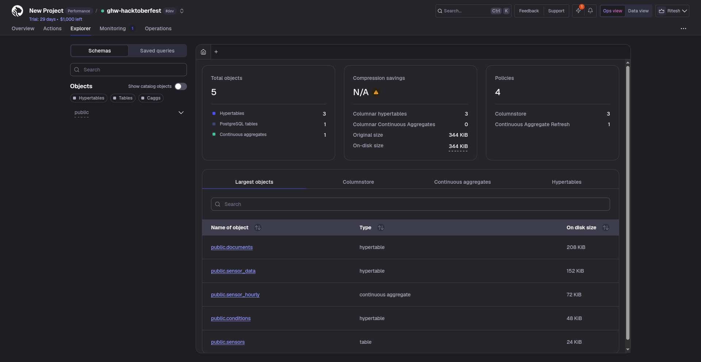

# Tiger Cloud challenges: MLH Global Hack Week: Hacktoberfest 2026

SQL for the Tiger Data challenges, run on a free Tiger Cloud service with the Tiger CLI (`tiger db query --file ...`).

| File | Challenge |
|---|---|
| `01-hypertable.sql` | Set up a Tiger Cloud service and create your first hypertable |
| `02-iot-sensors.sql` | Simulate an IoT sensor dataset (24 h x 4 sensors, 1,156 rows) |
| `03-continuous-aggregate.sql` | Accelerate dashboards with a continuous aggregate (`sensor_hourly`) plus refresh policy |
| `04-vector-search.sql` (built by `make_vector_sql.py`) | AI vector search with pgvector + pgvectorscale: similarity search filtered by time range and metadata |

Notes
- The vector demo uses a small feature-hashing embedding computed locally (64 dims) to keep it self-contained. Swap `embed()` for a real embedding model in production.
- Tiger MCP was installed for Claude Code with `tiger mcp install claude-code`.

